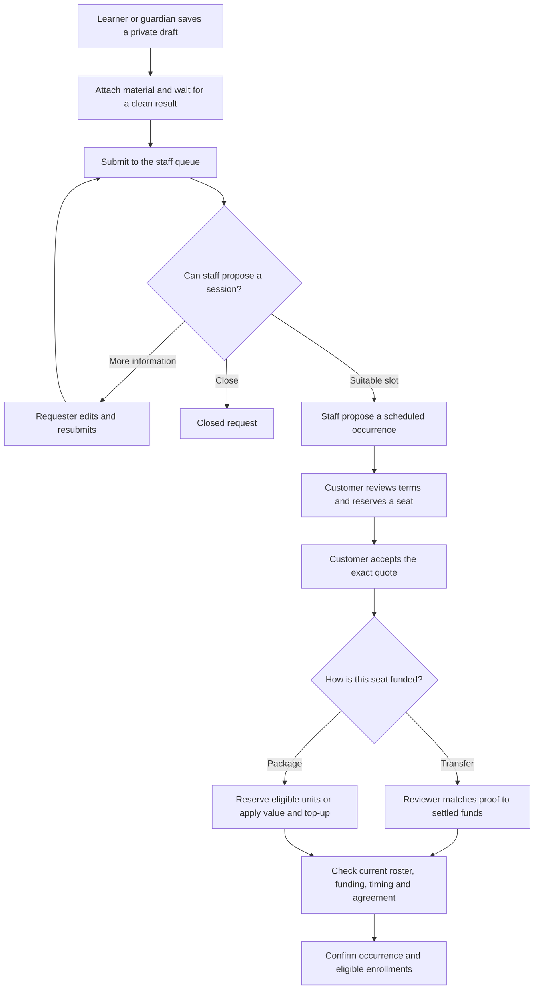
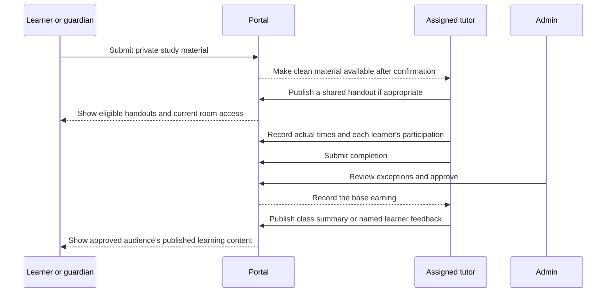

# Product and workflows

**Internal handoff · 18 November 2026**

Git Tutor helps a university learner bring their own course material, explain where they need help and agree on a session with a tutor. The operational records start with a learner and a request. Staff propose a suitable session, the customer reserves a place and accepts the terms, and the payment reviewer checks independent evidence. After teaching, the tutor records what happened and an administrator approves completion. Each step has a different owner and a different consequence.

The current public journey and rates come from the November 15 request update. Later sections use the underlying booking, finance and teaching contracts where those still govern. The hosted preview exercised the request-to-confirmation path with a real study file and synthetic settlement. A bounded November 18 pilot also demonstrated two-person admission to a real Google Meet. Commercial terms, production operations and the remaining acceptance work have separate approval gates. [Current request journey](../REQUEST-FLOW.md) · [Dated verification record](../IMPLEMENTATION-STATUS.md) · [Production decisions](../PRODUCTION-INPUTS.md)

## What visitors see and what a session costs

The public price is per learner for **one 90–105 minute session**, in Egyptian pounds. The matched session and its quote identify the exact duration, time and applicable terms. The group totals below assume every seat is sold at the public rate. A package may have its own coverage and carrying value. [Public tariff](../../contracts/runtime/public-tuition.json) · [Pricing display](../../src/components/catalog/tuition-comparison.tsx) · [Public price regression](../../tests/unit/public-tuition.test.ts)

| Study format | EGP per learner | Total public tuition for a full session |
|---|---:|---:|
| Individual | 650 | 650 |
| Two learners | 575 | 1,150 |
| Three learners | 550 | 1,650 |
| Four learners | 500 | 2,000 |

| Visitor destination | What the visitor can do |
|---|---|
| `/` | Read the examples, compare formats and prices, open the how-it-works and FAQ sections, then choose the main action leading to `/learn/requests`. |
| `/subjects` | Start with Computer Science, Engineering, Business or Business Intelligence. Selecting an example prefills a topic. “Request help with another subject” opens the same free-text form. Staff decide whether a tutor and a workable slot are available. |
| `/offers` and `/offers/[id]` | The first page compares public rates. An individual published offer has its own terms and scheduled options. The direct scheduled-booking path remains available alongside staff-assisted requests. |
| `/tutors/[id]` and `/apply-to-teach` | Read an approved public biography or start an application through a verified account. An administrator reviews applications, assigns staff membership and approves the tutor's public profile. |
| `/support`, `/login`, `/signup` | Get help, sign in or use registration when the environment allows it. The shared testing preview keeps signup closed. The sign-in flow can return the customer to their chosen request. |

The initial UI specification lists standalone policy, FAQ and how-it-works pages. In the reviewed source, the last two are homepage sections at `/#questions` and `/#how-it-works`. There are no dedicated `/privacy` or `/terms` pages in the route tree. Offer-level terms are available. Public policy-page publication remains an item to resolve for launch. [Home](../../src/app/page.tsx) · [Subjects](../../src/app/subjects/page.tsx) · [Public routes](../../src/app/) · [Original UI specification](../07-ui-spec.md)

## From a brief to a confirmed seat

1. **Save the brief.** A verified student selects themselves. A guardian selects the named learner and needs both current booking and materials permission. The form asks for a subject/topic, optional course, help needed, preferred Egypt times and format. Format choices are individual, a group of two, three or four, or undecided. Preferred times are a request in the learner's words. The proposed appointment later supplies the actual scheduled instants.
2. **Attach and submit.** Saving creates a private draft so the upload has a stable parent. At least one file must be attached. Every retained file must be finalized and clean before submission. Study files accept PDF, PPTX, PNG, JPEG and WebP up to 25 MiB each. The application checks the received bytes, size, type and checksum, including the contents of presentation archives. The requester can remove an unsuitable file and try again. Staff receive submitted requests in their queue.
3. **Review and reply.** Customer service or an administrator reads the brief and eligible materials, records a reply, marks it under review, asks for more information, matches it or closes it. The original requester can edit in draft or when staff ask for information. After submission, a properly scoped customer can see the status and the customer-facing reply. The server checks the current version when saving, so one reviewer cannot silently overwrite a newer decision.
4. **Propose an actual session.** Staff choose from eligible future occurrences. The system checks a sellable offer, current tutor, suitable format, exact elapsed duration in the 90–105 minute range, the public EGP tier and an open formation deadline. An undecided format allows the reviewer to consider several formats. For a future occurrence already confirmed, the matcher permits a link only when this learner already has a confirmed enrollment. Staff assess subject suitability from the material. Matching stores a proposal link. The student's capacity, charge and funding records start in later commands.
5. **Reserve and accept.** “Review and book this session” opens its specific offer and occurrence. The customer selects the learner, reviews the terms, requests a time-limited hold and accepts the exact versioned quote. A successful hold reserves a place temporarily. Accepting the current quote issues the enrollment charge. A fresh quote or renewed capacity decision is required once the applicable time or terms have changed.
6. **Fund and confirm.** A cash-funded customer follows the selected collection account's instructions, uploads a separate receipt and tracks the review. A valid named package can satisfy an eligible seat, while a value-funded package can leave an explicitly quoted cash top-up. The confirmation transaction checks consent, qualified funding, the current roster and an approved exact tutor agreement before confirming. The customer can see whether a payment review, booking or meeting is still pending.

[Request form and reviewer controls](../../src/components/requests/workspace.tsx) · [Database eligibility and permissions](../../supabase/migrations/20261115193000_tutoring_requests.sql) · [File type and size checks](../../src/modules/files/validation.ts) · [Request integration tests](../../tests/integration/requests.test.ts) · [Browser journey](../../tests/e2e/requests.spec.ts)

## Who works where

The account identifies the signed-in person. The learner identifies the person receiving teaching. A payer owns the source of funds. A tutor assignment identifies the person authorized to teach that occurrence. One family can therefore have two learners, one guardian and a different payer. A matching name, phone or email gives no authority to book, spend money or see a private file. Guardian invitations specify the permitted combination of profile, booking, payments, materials and notifications and have a validity period. [Identity commands](../../src/modules/identity/commands.ts) · [Role and guardian browser tests](../../tests/e2e/role-access.spec.ts)

| Workspace | Routine work and useful routes | Important access boundary |
|---|---|---|
| Learner and guardian | `/learn/requests` for briefs and replies, `/learn/bookings` and its detail page for holds, accepted terms, changes, countdown and joining. `/learn/files`, `/learn/packages`, `/learn/payments` and `/learn/refunds` show the relevant files, remaining package units, charges, evidence and masked refund history. Account links, support, notices and own-account exports are also available. | Select the learner for each action. A guardian with booking-only scope can have a different view from the payer. Removing a guardian link changes ongoing read and download eligibility. |
| Tutor | `/tutor` for profile and subject details, `/tutor/schedule` for availability, assigned meetings, rosters, materials and delivery, `/tutor/teaching` for operational changes, `/tutor/pay` for the tutor's statement, proposed destinations and payment progress. Notifications and own-statement exports are separate screens. | The assigned tutor can discover the matched request material after the learner's enrollment confirms. Reassignment changes access. Statements and agreements are personal to the assigned tutor. |
| Customer service | `/service/requests` to triage briefs and match sessions, `/service/payments` for the review queue and incoming-funds comparison, `/service/support` for conversations, `/service/customers` for authorized learner history and follow-up, `/service/notifications` for updates. | A staff role opens the request queue. Routine payment approval also requires ownership of the current case. The operational CRM limits service access to active case or follow-up scope. Historical workbook access has its own explicit grant. |
| Admin | `/admin/catalog` for policy and profile publication, `/admin/schedule` and `/admin/teaching` for assignments, exception handling and approval. Payment, refund, package, payroll and finance workspaces have distinct actions. `/admin/access` handles role grants and applications. `/admin/students`, `/admin/team`, `/admin/campaigns`, `/admin/sessions` and `/admin/exports` support review and reporting. | Staff check the current role inside sensitive operations. Publication requires complete approved terms. The original-workbook archive additionally checks exact batch ownership. An unrelated admin cannot open its raw records. |

[Role-aware navigation](../../src/components/portal-shell.tsx) · [Current learner and payer identities](../T10-CRM-CONTRACT.md) · [Request-material discovery](../../supabase/migrations/20261115195000_tutoring_request_material_discovery.sql) · [Scoped payment reads](../../tests/integration/payment-scoped-reads.test.ts)

## Scheduling, formation and changes

An **occurrence** is one scheduled teaching event with one tutor interval. An **enrollment** is a named learner's seat in it. A group therefore has one calendar event, multiple attendance records and one base earning after approved completion. Each affected learner can have a different payer, package, payment status or remedy. [Booking model](../T04-BOOKING-CONTRACT.md) · [Group completion test](../../tests/integration/group-completion.test.ts)

| Situation | What happens and where to follow up |
|---|---|
| Set availability | Tutors maintain recurring Cairo weekday intervals and dated exceptions. A dated exception replaces that day's weekly rule. An empty exception represents time off. Scheduling checks the whole interval, tutor availability and overlapping commitments. The system stores actual instants in UTC. Nonexistent local times fail validation and repeated wall times require an explicit offset choice. |
| Fill a forming group | Each learner holds and accepts their own quote at the intended group size. Admission checks physical capacity and the target tier. Under the ordinary path one remaining seat can go to only one learner, even across concurrent connections. The group needs the target roster, current acceptances, required funding and a current exact fee agreement before it can confirm. |
| Join a waitlist | The customer elects to join for a named learner. The worker expires holds and offers the oldest eligible waiting entry a fresh timed hold and quote. It rechecks current guardian authority. If an offer expires, the next eligible learner can receive an offer. The customer can leave the queue. |
| Miss a group deadline | A worker saves a formation decision under the pinned policy. Staff see the pending resolution and follow the applicable revised-quote or cancellation/funding process. A missed target does not by itself authorize a higher price for the remaining learners. |
| Add or remove a participant | Propose the precise roster, revised or protected seat price, consequences for the payer or package and the tutor's separate terms. Required people accept their own versions before approval and application. A guardian acting for two affected learners may have to accept twice. A changed roster, consent, quote or time limit can require a fresh proposal. |
| Move the time or change the tutor | A reschedule preserves the logical occurrence, checks its new time, updates accepted terms and queues calendar/reminder work. A change to a series selects specific future occurrences. Unavailability creates owned resolution cases for affected meetings. Tutor replacement requires the relevant learner and both tutors' consent plus admin approval. Newly assigned staff gain the applicable material access. |
| Move one learner to a different session | The source seat stays booked while destination capacity, new terms and any carryover are staged. Moving existing funds can require separate consent from the actual payer. Additional funds for the proposed destination cannot complete the move on their own. Admin applies the accepted proposal under current capacity and funding checks. The successor retains its link to the source enrollment. |
| Cancel a funded seat | Staff review the saved policy and exact charge, cash, credit or package consequence. Required parties accept the versioned proposal. Applying a remedy references the original funding source. A cash refund needs its own verified destination and settlement. A cancelled seat, account credit, returned package units and paid-out cash are distinct outcomes. |

[Schedule and overlap checks](../../src/modules/booking/scheduling.ts) · [Concurrent reservations](../../tests/integration/booking-concurrency.test.ts) · [Waitlist expiry and guardian revocation](../../tests/integration/booking-due-worker.test.ts) · [Group additions and removals](../../tests/integration/removed-seat-amendments.test.ts) · [Series and reassignment browser cases](../../tests/e2e/teaching-operations.spec.ts) · [Enrollment transfers](../T06-ENROLLMENT-TRANSFER-CONTRACT.md) · [Cancellation remedies](../../tests/integration/cancellation-remedies.test.ts)

## Money at the customer-service desk

The useful comparison at `/service/payments` has two sides. On one side are the issued charge, payer, beneficiary and latest eligible payer-uploaded receipt. On the other side are independently sourced incoming funds, receiving account, channel, currency, external reference, settlement and remaining allocatable amount. A rep claims the case, checks these items and allocates the allowed amount. A receipt is a document. A settled transfer is a cash fact. An allocation says how much of that transfer satisfies this specific obligation. The customer can see the review status while staff resolve a discrepancy. [Payment evidence checks](../../tests/integration/payment-evidence.test.ts) · [Independent reconciliation](../../tests/integration/payment-reconciliation.test.ts) · [Service and learner browser flow](../../tests/e2e/payments.spec.ts)

The specified Egyptian channels are InstaPay and Vodafone Cash. Customers obtain the relevant instructions from their charge detail. Receipts accept PDF, PNG, JPEG or WebP up to 5 MiB. If the proof is unreadable or superseded, the receiving account or currency differs, the transfer is pending, or someone has already used its available funds, the rep requests clarification or escalates. Statement import supports reconciliation work. Independently established settlement remains necessary to allocate money. The production collection destinations still need owner evidence. [Payment and channel requirements](../01-product-spec.md) · [File limits](../../src/modules/files/validation.ts) · [Statement review](../T06-MANUAL-STATEMENTS.md) · [Outstanding account setup](../PRODUCTION-INPUTS.md)

- **Partial or excess funds.** A partial allocation can meet the saved deposit rule and still leave tuition payable. Excess money remains traceable to the original payer. Assigning it to another obligation needs current source authority. Late money survives hold expiry and needs an explicit resolution with current capacity and terms. [Funding and allocation](../T06-FINANCIAL-CONTRACT.md) · [Payer plan tests](../../tests/integration/payment-payer-plans.test.ts)
- **Package purchase and use.** A purchase creates an obligation. The saved funding rule governs activation. Each lot tracks quantity and money independently. For the initial contract, 1,000 quanta represent a standard session for that contract's base duration. Reserve on booking, consume on qualifying delivery, release an unused reservation or restore a previous consumption through its reference. A compatible renewal moves the remaining units and their original value. An incompatible duration or partial named coverage requires reviewed terms. [Package contract](../T05-PACKAGE-CONTRACT.md) · [Activation](../../tests/integration/package-activation.test.ts) · [Transfers](../../tests/integration/package-transfers.test.ts)
- **Corrections and refunds.** Reversed transfers, corrected allocations, cash refunds and returned entitlement reference their sources. Unknown external outcomes keep the reservation pending reconciliation. A shared limit prevents granting both cash and reusable package value for the same benefit. Customer refund views mask the destination. [Transfer reversals](../../tests/integration/transfer-reversals.test.ts) · [Competing remedies](../../tests/integration/remedy-restoration-concurrency.test.ts) · [Refund privacy](../../tests/integration/refund-private-boundary.test.ts)

## Materials, teaching and published learning records

| Record or action | Practical meaning |
|---|---|
| Preparation material | Request material stays attached to its brief and is discoverable by the assigned tutor once the matched learner is confirmed. Enrollment-specific private preparation remains restricted to eligible people. A classmate cannot browse another learner's submissions. A tutor's shared handout requires explicit publication and confirmed class access. |
| Calendar and countdown | Each participant opens the current booking or assigned occurrence. The portal shows the schedule, countdown and meeting state. Ready access goes through an authenticated check of enrollment or assignment and the current meeting generation. A pending, failed or revoked room has a visible reason. Rescheduling and reassignment can make earlier access obsolete. |
| Delivery facts | Record actual start and end and each eligible learner's attendance. Present requires positive participation measured in seconds and bounded by the actual interval. Absence or excusal records zero seconds. Future factual teaching is rejected. An individual early departure and a shortened whole class have different remedies. |
| Completion and payroll | The assigned tutor submits an attendance snapshot. Admin reviews exceptions and the exact remedies, then approves. Completion posts the applicable enrollment effects and a single base tutor earning. Replaying that approval leaves one base earning. Later corrections reference the original and retain history. A tutor statement distinguishes earned, adjusted, reserved and settled amounts. Payment uses a separately verified destination. |
| Learning record | After approved completion, the assigned tutor or admin explicitly publishes a shared class summary, private feedback for a named learner, or both. Customers see the latest material they are entitled to. Admin/tutor revisions are retained. Internal attendance notes never prefill the publication form. Notifications point back to the portal and omit peer feedback. |

[Files and access tests](../../tests/integration/files.test.ts) · [Calendar access and race tests](../../tests/integration/calendar.test.ts) · [Completion review](../../tests/integration/completion-review.test.ts) · [Payroll](../../tests/integration/payroll.test.ts) · [Learning record contract](../T08-LEARNING-RECORD-CONTRACT.md) · [Visible learner and tutor flow](../../tests/e2e/learning-records.spec.ts)

## Support and notifications

**Website support.** An anonymous visitor can start a conversation and receive approved general FAQ answers. A direct request for a person or a sensitive unresolved question creates a human handoff. The bot pauses while a rep owns the conversation. Staff can claim, transfer, escalate, resolve or reopen it. Unassigned staff may preview the public transcript. Private notes are visible to the assigned owner or admin. For account-specific help the original thread owner begins a 15-minute single-use challenge. A verified user must present it and select a learner they currently have authority for. [Support evidence](../T11-SUPPORT-EVIDENCE.md) · [Browser linking and staff transfer](../../tests/e2e/support-linking.spec.ts)

**WhatsApp.** The public contact link opens the external communication channel. Automated replies use a different, provider-backed path. A genuine inbound WhatsApp message starts the 24-hour free-text window. An out-of-window message requires approved template parameters and explicit opt-in. STOP withdraws permission. Replies respect current ownership, opt-out and template approval again at dispatch. Ambiguous delivery remains on the case for reconciliation. Local checks cover duplicate/out-of-order events, bot suppression and revocation. Production account, approved templates and controlled live checks remain open. [WhatsApp boundary tests](../../tests/integration/support-whatsapp.test.ts) · [Production inputs](../PRODUCTION-INPUTS.md)

**Operational notifications.** Every workspace has a notifications inbox. Database events create durable work for the worker. Routing considers the learner, authorized guardian, actual payer, assigned tutor or staff owner, as appropriate. Reminders use the occurrence version and are scheduled at 24 hours and one hour. A reschedule supersedes stale reminders. Current role, guardian scope, verified contact and preferences are rechecked before dispatch. Customer messages give a safe summary and portal link. Private files travel through authenticated downloads. Admin can inspect delivery status, retry a definite failure or reconcile an unknown result. The documented Mailjet owner-only Auth invitation and recovery deliveries both reached Spam. The final-host sign-in journeys and routine production-worker mail remain separate checks. [Notification evidence](../T09-NOTIFICATION-EVIDENCE.md) · [Reminder tests](../../tests/integration/notification-scheduling.test.ts) · [Auth delivery result](../evidence/auth-mailjet-20261116.md)

## CRM, reporting and exports

| Operational question | Correct record, calculation and drill-down |
|---|---|
| Who needs a follow-up? | The customer register counts one row per learner. Staff can inspect verified contacts, observed contacts, scoped history, outstanding balances and due actions. Each follow-up has an owner, due time, channel and resolution. Observing a family phone number may open an identity-candidate review. An admin can record distinct identities or a reviewed alias and reason. Source IDs, payment ownership and guardian authority remain independently auditable. |
| What teaching and money were recorded? | The admin session register counts occurrences. Finance distinguishes earned tuition, received cash, receivables, unused packages, credits, refunds, tutor payables and expenses. Period and recorded cutoff affect interpretation. A payment on an undelivered class can increase cash while leaving a tuition obligation. A cash-reconciliation difference creates an investigation record. The underlying postings preserve both the original and its corrections. |
| Did a campaign acquire a new learner? | The cohort counts one durable learner. Select the lifetime first eligible inquiry before applying the Cairo business-date filter. A support inquiry requires a verified named-learner link or evidence review. Follow booking acceptance, net settled funding and first observed approved completed-present attendance with positive participation. Returning learners and people with incomplete history remain distinct. Complimentary first attendance can qualify with established lifetime history. A paid no-show never establishes attendance. |
| Can we report acquisition cost? | Separate independently verified campaign credit, verified organic and unknown sources. Compare newly taught learners with approved spend for the same basis and period. Missing or partial spend, zero acquired learners and an unsupported subject or format cost split leave acquisition cost unavailable. An expense-linked spend observation is counted once in operating accounts. The cohort export reconciles to the same filters and counts. |
| How busy is the team? | Tutor delivered time counts actual approved duration once per occurrence, including groups. Workload can also report available capacity, waiting age, time to first human reply and ownership intervals. The report labels elapsed time and staffed-hours coverage separately. A missing staffed schedule cannot substantiate a staffed response-time claim. |
| Which export should I request? | Learner/guardian own-account exports use enrollment grain and current permissions. Tutor statements use earning grain. Admin directories use learner grain, session exports use occurrence grain, and financial exports use payment-allocation grain. Multiple guardians do not create extra session revenue. The job saves permitted filters, columns, cutoff and immutable rows. CSV neutralizes spreadsheet formula prefixes. The private result expires after 24 hours and download rechecks current authority. |

[CRM and export schemas](../T10-CRM-CONTRACT.md) · [CRM and export access tests](../../tests/integration/crm-exports.test.ts) · [Finance reporting controls](../../tests/integration/finance-report-controls.test.ts) · [Acquisition and workload definitions](../T12-ANALYTICS-EVIDENCE.md) · [Campaign report tests](../../tests/integration/analytics.test.ts)

## Workbook history in the private operational preview

The owner separately authorized the historical workbook import. The source archive preserves the reported values and the original row reference. Its 139 rows do not describe 139 unique learners, classes or collectible balances. The separate operational preview maps canonical people and courses to source rows and can show that history inside the ordinary workspaces. New practice activity runs through normal application commands. The clean production target has its own data boundary. [Actual import reconciliation](../ACTUAL-DATA-IMPORT.md) · [Operational integration plan](../OPERATIONAL-DATA-PLAN.md) · [Current production check](../IMPLEMENTATION-STATUS.md)

| Source section | Rows | Meaning |
|---|---:|---|
| Sessions | 85 | 75 dated and 10 undated. Only 72 intervals were complete and valid for Cairo-to-UTC conversion. |
| Packages | 10 | All ten start dates were missing. Package labels, progress and renewal references are historical observations. |
| Student and tutor profiles | 5 + 11 | These seeded canonical mappings in the separate preview. Ambiguous labels in other rows may refer to additional people. |
| Marketing and distribution | 2 + 1 | Source-reported entries, preserved for review. |
| Balance/action snapshots | 25 | Reported summaries may overlap session and package data. Never sum these three views as independent transactions. |

**Trace a discrepancy.** On the owner's admin overview, a chart value opens the corresponding source rows. The workbook register supports search, filters and pagination. The batch owner can inspect all seven sections at `/admin/workflow` and review uncertain mappings. Source and normalized content checksums identify the immutable batch. A repeated matching import reuses it. A changed normalization for the same source is refused. Mapping review saves a reason and version. The original workbook evidence survives the review. [Import evidence](../ACTUAL-DATA-IMPORT.md) · [Operational workspace and chart controls](../../src/components/workflow-import/operational-workspaces.tsx) · [Mapping and privacy tests](../../tests/integration/workflow-operations.test.ts)

**Handle unknowns explicitly.** The import identified 18 normalized course labels and 39 records with 72 issues. There were 20 missing dates, 13 missing courses, 11 missing starts, 12 missing ends, 15 ambiguous person labels and one invalid interval. Keep generic learner/group labels unresolved until supporting evidence distinguishes them. A workbook contact is unverified. A reported paid/completed label is not sufficient evidence to issue transferable credits, post funds, award tutor pay, confirm attendance or count a newly taught learner. Opening balances and active entitlements require a separately reviewed conversion with ownership and source evidence. [Source-quality counts](../ACTUAL-DATA-IMPORT.md) · [Versioned import model](../../src/modules/workflow-import/operational-model.ts) · [Import regression](../../tests/integration/workflow-import.test.ts)

**Use the right projection.** The owner has the source archive. Other roles receive only the authorized operational view. A learner or guardian sees mapped rows under the current scope, with financial fields restricted by payment authority. A tutor sees assigned reported history and their own reported compensation. A service user needs a batch-specific grant and receives the approved service fields. Removing an applicable grant or guardian link takes effect on subsequent reads. The import does not send invitations to the original contacts. [Role boundary](../../tests/integration/workflow-operations.test.ts) · [Operational model](../../src/modules/workflow-import/operational-model.ts)

## Worked example using fictional people

This example combines an exercised preview path with separate automated teaching and reporting scenarios. The names, topic and dates are illustrative. It describes how a colleague can follow the records without sending money, opening a room or accessing a customer account.

1. **Intake.** Sam, a fictional student, wants help interpreting microscope images from a university course. Sam opens “another subject,” asks for an individual session, enters Cairo availability and saves a draft. Sam attaches a synthetic lecture PDF. On a clean result, Sam submits it. Staff ask which chapter to prioritize. Sam revises the brief and resubmits.
2. **The appointment.** An administrator schedules an eligible 90-minute individual session with approved example terms and an assigned tutor. The rep matches it to Sam's brief. Sam reviews the date, selects the correct learner, holds the seat and accepts the EGP 650 quote. At this point the app has a charge and an unconfirmed booking.
3. **The receipt.** Sam uploads a separate practice receipt. The service rep claims the case, locates the independently prepared EGP 650 settled-transfer record, verifies the price and destination, and applies one allocation for 65,000 minor units. With all timing, roster and agreement checks satisfied, the enrollment and occurrence confirm. Repeating the same approval cannot create a second collection.
4. **Class preparation.** The assigned tutor finds the original brief's PDF through Sam's confirmed roster entry. Sam and the tutor see meeting readiness in their own portals. An unrelated learner has access to neither the PDF nor the room. Publishing a class handout would give the confirmed audience a separate shared file.
5. **Delivery and follow-up.** After the lesson, the tutor records the real interval and Sam's positive attendance, then submits completion. Admin approves once. The tutor can now publish feedback to Sam and check the earning in their own statement. A CRM follow-up can record who will check on the next topic and when. If this was Sam's first qualified attendance and history was independently established as complete, the relevant cohort can count one newly taught learner.

The hosted walkthrough verified the request, scan under a simulated scanner, independent **synthetic** settlement, confirmation and tutor download. The later two-person pilot verified Google admission and moved EGP 0. The delivery, learning record, payroll and cohort assertions have separate test evidence. Production group-call duration, final-host organizer and Auth behavior, live upload quarantine, verified collection accounts and commercial policy approval remain open. Full application CI passed 168 desktop/mobile browser tests at revision `459de31`. The formal acceptance register still recorded 147 cases as not run on November 18. [Hosted and CI evidence](../IMPLEMENTATION-STATUS.md) · [Controlled completion tests](../../tests/integration/completion.test.ts) · [Learning record tests](../../tests/integration/learning-records.test.ts) · [Cohort tests](../../tests/unit/cohorts.test.ts) · [Outstanding launch work](../PRODUCTION-INPUTS.md)
