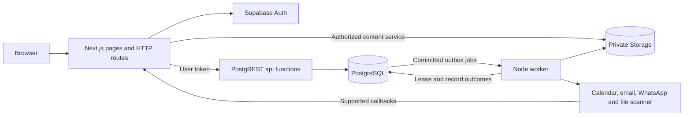
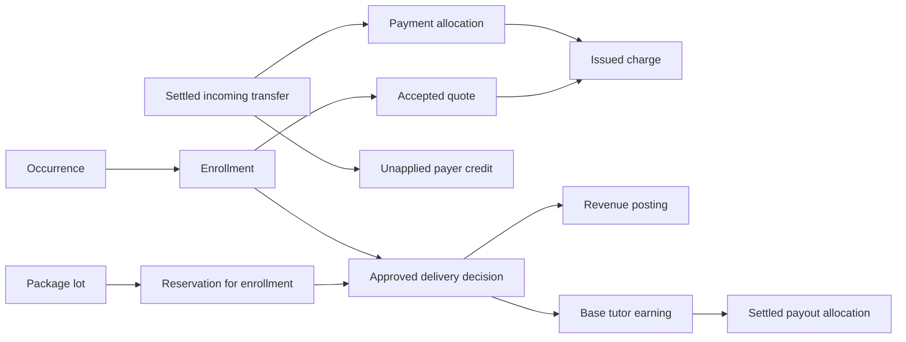
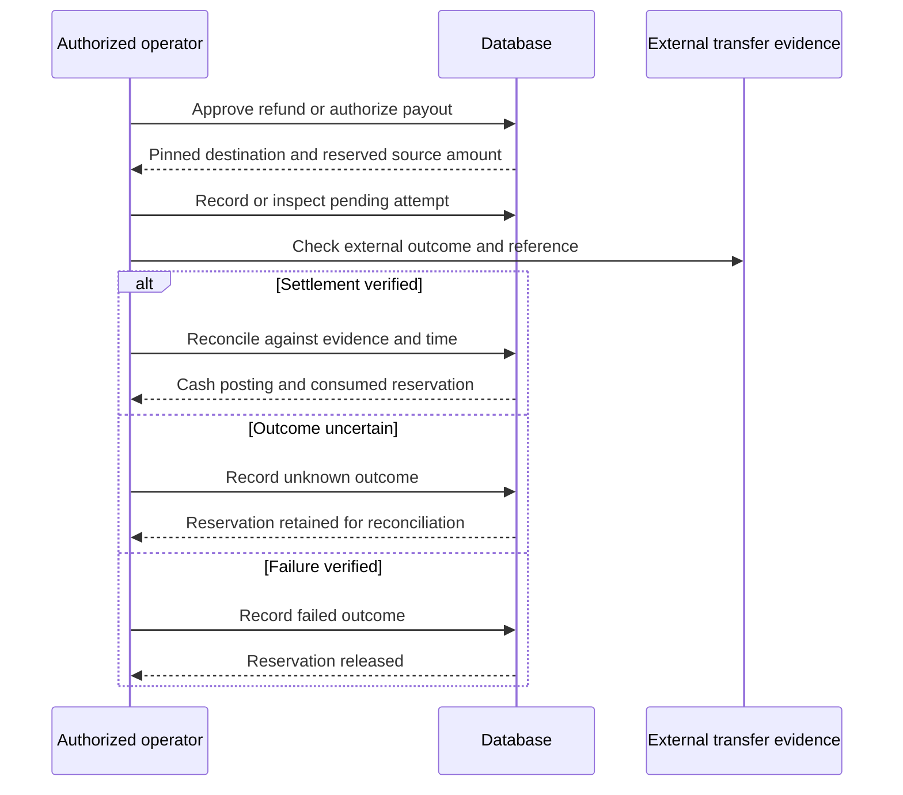

# Architecture and money

Start with one scheduled class. Its **occurrence** owns the time, teaching assignment and capacity. An **enrollment** identifies one learner's place in that occurrence. The accepted quote establishes the commercial terms for that seat. A **transfer** identifies money received, and an **allocation** identifies how much of that transfer pays a particular charge. Approved delivery establishes what was earned. These records can reach different states on the same day. To explain a customer's balance, follow the links between them. [Business rules](../02-business-rules.md) · [Data model](../04-data-model.md)

## Where the application runs



The web and worker processes share a migrated database. The web can accept a booking while the worker is offline. The booking remains committed and due work accumulates. An operator investigating a missing meeting should inspect the booking's confirmation state, then the calendar job, event and provider outcome. The worker's heartbeat measures process activity separately from a successful delivery. [Worker entry point](../../src/worker/index.ts) · [Calendar worker](../../src/worker/calendar.ts) · [Deployment](../DEPLOYMENT.md)

| Start here | What it owns |
|---|---|
| [Package manifest](../../package.json) and [Node version](../../.node-version) | Node 24.22.1, pnpm 11.25.0, Next.js 16.4.6 App Router, React 19.3.1, TypeScript 5.9.3, Zod, Supabase SSR/JS, node-postgres, Vitest and Playwright. PostgreSQL 17 is configured in [Supabase](../../supabase/config.toml). |
| [Pages](../../src/app) and [components](../../src/components) | Public website, student/guardian, tutor, customer-service and admin views. Server-rendered pages can call a domain query with the session client. Interactive components also use same-origin HTTP routes. |
| [Domain modules](../../src/modules) | Identity, catalog, requests, booking, packages, payments, teaching, tutor pay, files, CRM, notifications, support, analytics and workbook import. Commands and queries define the business inputs and the response shapes each caller may receive. |
| [Server](../../src/server) | Auth and cookies, HTTP validation, restricted file and destination services, provider configuration, webhook validation and adapters. The browser never needs a database password or private Storage key. |
| [SQL migration history](../../supabase/migrations) | Durable records, command implementations, grants, locks, financial postings and read projections. Follow later replacements and renamed helper functions when tracing a command. An early migration establishes only the version at that point in history. |
| [Contracts](../../contracts), [fixtures](../../fixtures) and [tools](../../tools) | Commercial authoring, customer-facing projections, synthetic scenarios, migration and verification tools. Keep the separate private workbook environment and its imported observations outside synthetic tests. |
| [Acceptance map](../08-acceptance-tests.md) and [implementation status](../IMPLEMENTATION-STATUS.md) | The business case, the recorded execution and outstanding gates. Individual passing checks and formal acceptance have separate records. |

For a synthetic Windows checkout with the pinned runtimes, PostgreSQL 17 binaries and Docker's Linux engine available, run the first block from the repo root. Open another terminal at the same root for the worker. The local application normally serves on port 3000. The Supabase gateway is on 54321, Supabase PostgreSQL on 54322, and the captured verification inbox on 54324. The native 55432 cluster supports the isolated foundation suite. The environment guards protect the test targets. Point both processes at the intended development setup before starting them. [Local testing](../LOCAL-TESTING.md) · [Test target guards](../../tests/helpers/environment.ts) · [Supabase test helpers](../../tests/helpers/supabase.ts)

```powershell
pnpm install --frozen-lockfile
pnpm db:start
pnpm db:migrate
pnpm seed:synthetic
pnpm dev
```

```powershell
pnpm worker:dev
```

## Trace a normal request

1. A learner or authorized guardian saves a tutoring request, attaches preparation files and submits it for staff review. Staff can propose an eligible scheduled occurrence. The match is an invitation to review its terms. Capacity and receivables first change in the subsequent booking flow. The request family has its own route handler. [Request workflow](../REQUEST-FLOW.md) · [Request routes](../../src/app/api/v1/requests/%5B%5B...path%5D%5D/route.ts)
2. In the booking workspace, choosing a place sends `POST /api/v1/occurrences/{id}/holds` with a learner ID and an `Idempotency-Key`. The catch-all dispatcher matches the method and path, checks the configured origin for mutations, verifies session claims, rejects extra body fields and supplies the occurrence ID from the path. It calls the booking module with typed arguments. Common JSON reads reject unrecognized or duplicate filters. Ordinary JSON bodies in the shared reader are bounded to 64 KiB. [Customer booking UI](../../src/components/booking/customer-bookings.tsx) · [Central dispatcher](../../src/app/api/v1/%5B...path%5D/route.ts) · [HTTP helpers](../../src/server/http.ts)
3. The module validates inputs and invokes `api.reserve_enrollment` through the caller's Supabase client. The SQL entry point dispatches to the private booking command. SQL checks the current learner relationship, eligibility, capacity and hold deadline, then records the enrollment and versioned quote. The command commits its audit and required events with the change. The module validates the response against an explicit data transfer object (DTO) before the application returns it. [Booking command contract](../../src/modules/booking/commands.ts) · [Initial booking RPCs](../../supabase/migrations/20261111125622_booking_core.sql) · [Admission and deadline checks](../../supabase/migrations/20261111134228_booking_admission_boundaries.sql)
4. The customer retrieves the quote and sends `POST /api/v1/quotes/{id}/accept` with the exact quote hash and current version. The resulting acceptance provides the charge's source. Funding is evaluated separately for each enrollment. Confirmation also needs the applicable roster, time, available tutor and exact approved fee agreement. A fully funded member of a forming group may still be waiting for other members. [Charge attachment](../../supabase/migrations/20261111160218_booking_charge_attachment.sql) · [Booking and funding checks](../../tests/integration/booking-funding.test.ts)

In the common dispatcher, a successful reply has `data` and `request_id`. Errors carry an allowlisted `code`, message and request ID. Use that ID to trace an individual HTTP attempt. Keep the business idempotency key for retries of the same intent. An authentication failure returns 401, denied scope 403, unrecognized fields 400, and stale versions or full capacity 409. A retryable transactional conflict maps to 503. On a version conflict, reload the authoritative read and let the actor review any changed terms. On a lost response, replay the same normalized business request with its original key. Reuse of that key with changed arguments returns `IDEMPOTENCY_CONFLICT`. [Safe errors](../../src/server/http.ts) · [Booking transport tests](../../tests/e2e/booking-transport.spec.ts)

Several route families have dedicated handlers, including requests, CRM, exports, notifications, analytics, support, learning records and binary file content. Auth callbacks, calendar OAuth and provider webhooks also have their own entry points. Look in the specific directory before adding an overlapping catch-all rule. [HTTP route tree](../../src/app/api) · [API contracts](../05-api-contracts.md)

## Authority, locking and time

The proxy refreshes the session, carries refreshed cookies onto the response and marks protected responses private and non-cacheable. Server-rendered pages use `requireAccount` for role-based navigation. Sensitive commands establish authority again inside SQL. The verified subject and session ID must still correspond to an active Auth session and application account. Current role rows, learner links, tutor assignment and case ownership determine what the actor can do now. A stale tab can therefore lose access between rendering a button and clicking it. [Proxy](../../src/proxy.ts) · [SSR clients](../../src/server/supabase.ts) · [Portal guard](../../src/server/auth.ts) · [Database session check](../../supabase/migrations/20261111112214_identity_auth_bridge.sql)

| Actor or boundary | Decision to check |
|---|---|
| Public visitor and guest chat | The anonymous database role has the two sanitized catalog reads. Guest support uses an anonymous **Auth session** with narrow access to its own conversation. Linking that conversation to a verified identity uses a single-use challenge. |
| Learner, guardian and payer | Select a durable learner ID. Guardian links carry independent `profile`, `booking`, `payments`, `materials` and `notifications` scopes and validity periods. The actual source payer can retain rights over their transfer after a guardian link ends. Rights over another learner's bookings require the applicable relationship. |
| Tutor and staff | Tutor access follows the assignment or their own pay statement. Customer service can claim review work and act within current case ownership. Admin approvals, payout destinations and finance reports have separate checks. A booking entitlement gives no authority to inspect compensation. |
| PostgreSQL and DTOs | Supabase exposes only `api`. The base tables in `app_private` and `finance_private` use row-level security (RLS) and have no browser table grants. Narrow `SECURITY DEFINER` functions use explicit grants, qualified objects, a fixed search path and restricted owner roles. SQL constructs the role-specific projection. TypeScript validates it before serialization. Review the grants and DTO together. |

[Security and integration contract](../06-security-integrations.md) · [Identity integration tests](../../tests/integration/identity.test.ts) · [Migration security tests](../../tests/integration/migration-security.test.ts) · [Catalog confidentiality tests](../../tests/integration/catalog-privacy.test.ts)

**Replays and races.** The database stores command results keyed by actor, command name and idempotency key, with a hash of the accepted arguments. Sensitive commands check current authority before replay. Mutable records use expected versions. For changes spanning bookings and money, discover the affected records first and lock the union in a stable order. The financial contract orders tutors, occurrences and enrollments before review cases and receipt evidence, then learner financial locks, package purchases/lots/reservations, charge accounts, transfers, credits and refund records. Sort multiple IDs at the same level. After locking, recheck the source graph and available amounts. Changes in that graph may require a retry. Independent database connections exercise last-seat contention, duplicate allocation and remedy ownership. [Financial lock order](../T06-FINANCIAL-CONTRACT.md) · [Booking and finance locks](../../supabase/migrations/20261111173657_booking_financial_entry_locks.sql) · [Booking concurrency](../../tests/integration/booking-concurrency.test.ts) · [Allocation and reversal races](../../tests/integration/allocation-reversal-concurrency.test.ts)

**Time.** Persist instants with offsets and compare them as UTC instants. Derive local schedules and report boundaries in `Africa/Cairo`. Local schedule resolution returns candidates for an ambiguous wall time and none for a skipped time. Compute actual duration from elapsed seconds. Admission and approval recheck deadlines against the database clock. An expired hold stops counting towards capacity even if the worker has yet to update its displayed state. In financial reporting, `effective_at` places an event in its economic period and the recorded/posted cutoff controls what was known as of the report. [Cairo scheduling](../../src/modules/booking/scheduling.ts) · [Boundary tests](../../tests/integration/booking-time-boundaries.test.ts) · [Finance projections](../../src/modules/analytics/finance.ts)

## Background work and private content

An outbox is a database queue written in the same transaction as the change that creates the work. The worker claims due rows with `FOR UPDATE SKIP LOCKED`, commits a lease token and expiry, and then calls a handler. Finalization requires the matching lease. On a later attempt, `executeLeasedJob` asks the handler to reconcile first. A known success can finish the previous attempt, a known unsent outcome can dispatch again, and an uncertain outcome enters reconciliation. This matters when a provider accepts a request immediately before the worker loses its connection. [Outbox SQL](../../supabase/migrations/20261111103635_foundation_outbox.sql) · [Claim and completion functions](../../src/worker/claims.ts) · [Worker execution](../../src/worker/execute.ts) · [Crash and replay tests](../../tests/integration/worker-recovery.test.ts)

Registered handlers cover staff invitations, due bookings and packages, statement validation, scans, calendar synchronization, notification routing/sending, exports and WhatsApp. Inspect the handler for the purpose, its private prepare/finalize SQL, and the selected adapter. For example, a notification recipient's current authority and verified contact are relevant at delivery time, and a booking can retain confirmation while a Meet link is pending. The preview has a narrowly scoped live Calendar booking pilot. Cash transfers, refunds and payouts in the application require independent evidence and reconciliation. [Worker registry](../../src/worker/index.ts) · [Adapters](../../src/server/providers) · [Scoped Calendar pilot](../../supabase/migrations/20261118135000_scoped_calendar_booking_pilot.sql) · [Provider and release status](../IMPLEMENTATION-STATUS.md)

**Private upload lifecycle.** `POST /api/v1/files` creates an intent for a permitted purpose, parent, filename, size and SHA-256 checksum. The caller uploads bytes to `/api/v1/files/{id}/content`. The user-token RPC authorizes the operation. The server obtains its object descriptor through restricted SQL, validates size, hash and file contents, writes an immutable object generation, and records it. The private bucket is `git-tutor-private`. Larger uploads can travel in 3 MiB parts before full reassembly and validation. Materials are capped at 25 MiB and receipts at 5 MiB. Finalization requests a scan. A clean observation must match that generation. Quarantine, an incomplete scan or an unverified upload blocks use of the file as clean evidence. [Byte transport](../../src/modules/files/transport.ts) · [Content validation](../../src/modules/files/validation.ts) · [Storage service](../../src/server/files.ts) · [Scan worker](../../src/worker/file-scan.ts)

On download the server authorizes the actor, verifies the object's bytes, and checks current authorization and object version again before responding. Private preparation is scoped to the learner, authorized relationship and appropriate teaching assignment. Group handouts require explicit publication and eligible enrollment. A request attachment has its own request scope, with a separate authorized teaching-material discovery path after matching. Receipts and statement evidence follow the financial action and ownership that permit their use. Passing a scan establishes file safety for the relevant workflow. Independently verified funds are still required for settlement. [File access contract](../T07-INTEGRATION-CONTRACT.md) · [Request material discovery](../../supabase/migrations/20261115195000_tutoring_request_material_discovery.sql) · [Private file integration checks](../../tests/integration/files.test.ts)

## Money by source



All monetary amounts are integer EGP minor units. EGP 1 equals 100 minor units. Preserve both currency and the referenced pricing/policy versions. Store the exact privileged teaching agreement for an occurrence. Public tuition and customer DTOs have their own projection. On the current public request flow, an individual session is EGP 650. Groups of two, three and four are EGP 575, 550 and 500 per learner respectively, for a 90–105 minute session. The actual sale still needs the appropriate approved offer, policy, quote and acceptance. [Request pricing](../REQUEST-FLOW.md) · [Pricing modules](../../src/modules/catalog) · [Public tuition tests](../../tests/unit/public-tuition.test.ts)

| Question | Record or operation that answers it |
|---|---|
| What does this learner owe? | The accepted quote or purchase creates an issued charge with immutable source. Add linked debit/credit adjustments and apply the net qualifying allocations. Paid, partially paid and unpaid are derived balances. |
| What did the customer submit? | Receipt evidence identifies the uploader, target, file and evidence version. The current reviewer owns a case. A screenshot or recorded claim by itself creates no cash. |
| What entered the receiving account? | Independently verified settlement of an incoming transfer records the full amount, account, channel, currency and external identity. Duplicate source references are guarded. Unmatched settled money remains a cash entry and an unapplied obligation pending review. |
| Who can allocate or recover that money? | The transfer's payer binding, credit lots and accepted allocation plan establish authority. CS rechecks current claim, permitted proof, target debt, source availability and consent at posting. An authorized plan can span charges. A guardian relationship alone cannot assign a different payer's money. |
| Which service has been paid for? | An allocation links an original transfer to an exact charge. Package value and eligible named-unit reservations have separate source records. A receipt, settlement, allocation and confirmation have distinct IDs and effects. |
| What was earned or returned? | Approved delivery/cancellation decisions and immutable ledger transactions supply revenue, entitlement use and tutor earnings. Refund outcomes, reversals and settled payout allocations identify the actual outgoing or returning value. |

[Payment routes](../../src/server/payment-http.ts) · [Payment command schemas](../../src/modules/payments/commands.ts) · [Financial source graph](../../supabase/migrations/20261111162539_financial_source_graph.sql) · [Current proof and settlement tests](../../tests/integration/payment-evidence.test.ts)

### Worked example — payment for one group seat

Assume a synthetic four-person class with accepted terms of EGP 500 per learner. Follow one seat and one payer only. Other seats, expenses and payroll are outside this example.

| Event | Effect for this seat and payer, in EGP |
|---|---|
| Quote accepted and EGP 500 charge issued | Receivable 500, deferred tuition 500. No cash has been observed and earned revenue is zero. |
| Customer submits proof showing 550 | The case can be reviewed. The charge and cash balances are unchanged. |
| Staff independently verifies a settled 550 transfer | Cash increases by 550. Unapplied funds increase by 550. Bind the actual payer and review the intended charge. |
| Current reviewer allocates 500 | Receivable falls to zero. Unapplied funds fall to 50, traceable to the original payer and transfer. The allocation adds no cash. The other formation conditions still decide whether the class can confirm. |
| Full qualifying delivery is approved | Deferred tuition falls by 500 and earned tuition increases by 500. Separately, the approved completion produces one base tutor earning for the occurrence. |
| Payer's 50 surplus is refunded | Approval reserves 50. A pending or unknown attempt retains it. Verified settlement reduces cash and the source obligation by 50. Net cash from these transfers is 500, and earned tuition remains 500. |

For an installment, allocate only the verified portion and keep the remaining charge outstanding. Apply the saved deposit basis and rounding rule to determine the threshold for confirmation. If a transfer arrives after a seat expires, record settlement and preserve the payer's value. A new admission needs fresh capacity and current terms. Correct an allocation to the wrong seat by reversing the original allocation and posting a newly authorized one. A bank reversal with an ambiguous impact across learners records the cash loss and opens an owned exception pending an evidenced resolution. [Allocation tests](../../tests/integration/payment-allocations.test.ts) · [Late funding and booking](../../tests/integration/booking-funding.test.ts) · [Bank reversals](../../tests/integration/transfer-reversals.test.ts) · [Linked allocation corrections](../../tests/integration/allocation-corrections.test.ts)

### Package entitlement and renewal

A purchase saves the contract version and creates the purchase charge. Purchased quanta become usable when the saved funding rule qualifies. Purchased, promotional and transferred lots retain their own source, expiry and carrying value. A financing loss can place the purchase under review and block further use until it qualifies again. A standard session under its package contract represents 1,000 `credit_quanta`. Quantity and carrying value move together, each with its own exact balance. [Package contract](../T05-PACKAGE-CONTRACT.md) · [Package activation](../../tests/integration/package-activation.test.ts) · [Funding loss and requalification](../../tests/integration/package-financing-requalification.test.ts)

For each lot, the following identity holds independently for quanta and for minor-unit carrying value. Consumption is net of referenced restorations.

```text
grants + transfers in + signed adjustments
    = available + reserved + consumed + expired + transfers out
```

Reservation moves an identified portion from available to reserved. Release returns that reservation under its expiry policy. Approved consumption charges the reserved allocation. A restoration references a particular consumption and its remaining eligible value. Renewal can create purchased units on a successor and transfer compatible available units from a predecessor. The paired entries carry the actual remaining value, preserve lot ancestry and prevent cycles and reuse. Different durations require accepted, bounded conversion terms. Sequential allocation uses remaining value and quantity, assigning any final remainder to the last portion. Batch allocation uses largest remainder and a stable ID tie-break. [Value arithmetic](../../src/modules/packages/value.ts) · [Private movement kernel](../../supabase/migrations/20261111145234_package_private_movement_kernel.sql) · [Renewal and transfer tests](../../tests/integration/package-transfers.test.ts)

**The same lot under two alternative synthetic contracts.** A full eligible entitlement carries EGP 250 (25,000 minor units). A standalone seat would be EGP 575. Under **named service coverage**, reserving the required 1,000 quanta covers the eligible service, the additional tuition receivable is zero, and approved full delivery recognizes EGP 250 from the lot. Under **allocated value with explicit top-up**, applying EGP 250 against EGP 575 leaves EGP 325. If this example's saved deposit rule is 50%, the threshold is EGP 287.50, so another EGP 37.50 qualifies that funding threshold and EGP 287.50 remains collectible after that payment. Final delivery recognizes its package-funded and cash-tuition portions once each. [Funding arithmetic](../../src/modules/booking/funding.ts) · [Package cash coverage](../../tests/integration/package-cash-coverage.test.ts) · [Approved package consumption](../../tests/integration/completion-packages.test.ts)

### Changes to a booked class

**Changing a group tier.** Stage a proposal with the affected enrollments, terms, expiry and exact revised teaching agreement. For a synthetic move from two to three seats, the original tuition totals EGP 1,150. At the three-person tariff, credit EGP 25 against each original seat and charge the new seat EGP 550. The new total is EGP 1,650. The original charges remain visible. Apply each reduction first to unpaid debt, then return any surplus allocation as source-owned credit. Material changes require fresh affected consent. The commit checks funding, consent, capacity, current versions, time and agreement, then applies the roster and linked financial entries together. A decline or expiry releases provisional holds and leaves any actual money for resolution. [Booking contract](../T04-BOOKING-CONTRACT.md) · [Funded amendment tests](../../tests/integration/funded-amendments.test.ts) · [Removed seat tests](../../tests/integration/removed-seat-amendments.test.ts)

**Moving a learner to another occurrence.** The implemented enrollment transfer is between future sessions of the same offer. The initial request leaves the source active and reserves no destination place. Admin review creates a real destination hold and a separate transfer link. Learner acceptance pins the destination quote and reviewed source consequence. New qualified payments can fund the conditional destination charge. Carrying existing allocations requires exact consent from each original payer, plus the applicable booker and tutor decisions. The commit locks both sides, reverses and reapplies the approved portions of the original source, records the source cancellation consequence and evaluates destination confirmation. A destination group may still be forming. On expiry the destination hold is released, the source remains active, and genuine new destination funds go to an owned resolution. [Enrollment transfer contract](../T06-ENROLLMENT-TRANSFER-CONTRACT.md) · [Independent payer security](../../tests/integration/enrollment-transfer-security.test.ts) · [Transfer boundaries](../../tests/integration/enrollment-transfer-boundaries.test.ts)

**Cancelling or correcting delivery.** Preserve the accepted policy, roster, actual times, per-enrollment attendance and immutable decisions. Absent or partial participation by one learner and a shortened whole class can have different financial outcomes. Tutors submit factual completion, and admins approve qualifying delivery and reviewed remedies. Approval consumes the exact package allocations, recognizes eligible tuition, and creates the base earning once. Later adjustments reference the original decision and record evidence, reason and effective time. Cancellation, reassignment and other authorized awards have specific source obligations. A published class summary or private learner feedback is an explicit later publication. [Completion contract](../T08-COMPLETION-CONTRACT.md) · [Delivery review](../../tests/integration/completion-review.test.ts) · [Source award checks](../../tests/integration/tutor-awards.test.ts) · [Learning record contract](../T08-LEARNING-RECORD-CONTRACT.md)

### Money sent out and returned



| | Refund to a payer | Payout to a tutor |
|---|---|---|
| Eligible source | Trace to unspent settled credit or an approved original-benefit remedy. Bound the total by prior losses, applications, refunds, reservations and benefits already returned. Reserve a cash remedy or entitlement restoration against the same source only once. | Select the same tutor's unpaid, posted earnings and eligible adjustments. Authorization reserves exact allocations against those earnings and pins a verified destination version. |
| During an unknown attempt | The reservation remains until independent evidence resolves the attempt. A new outgoing transfer could duplicate a payment that already succeeded. | The reserved amount remains owed to the tutor. Available for another authorization equals the positive remainder of owed less active reservations. |
| Successful outcome | Verified settlement posts the outgoing cash and consumes the reservation. A subsequent evidenced bank return creates a linked incoming posting and payer-owned returned value. It preserves the original remedy history. | Only settled payout allocations reduce owed. A verified return restores the associated obligation through linked reversal allocations. A verified failure may be followed by a new, linked retry. |
| Where to verify | [Refund outcomes](../../tests/integration/refund-cash.test.ts) · [Refund concurrency](../../tests/integration/refund-concurrency.test.ts) · [Competing remedies](../../tests/integration/refund-remedy-ownership.test.ts) | [Payroll commands and statements](../../src/modules/tutor_pay/payroll.ts) · [Payroll concurrency](../../tests/integration/payroll-concurrency.test.ts) · [Statement cutoff fix](../../supabase/migrations/20261113185000_payroll_current_reservation_cutoff.sql) |

Ordinary views return masked destination details. The privileged server encrypts a submitted identifier and obtains database-authorized validation for the exact destination version. Verification needs independent evidence. A reveal requires current privileged authority, a specific eligible attempt and a recorded reason. The encryption boundary and its replay behavior are tested separately from cash posting. [Identifier handling](../T06-PRIVATE-IDENTIFIERS.md) · [Refund boundary tests](../../tests/integration/refund-private-boundary.test.ts) · [Payout destination transport tests](../../tests/unit/payout-destination-transport.test.ts)

## Reading reports without double-counting

| View | Grain and interpretation |
|---|---|
| Admin finance | A balanced ledger transaction groups signed lines whose total is zero per currency. Cash is actual settled money in and out. Revenue follows qualifying service or an approved earned cancellation outcome. Deferred tuition, unused package value and unapplied funds are liabilities. Tutor expense arises when an earning posts. Paying it affects cash and payable. Incurred and paid overhead are separately recorded. Use the summary to select a period and recorded-as-of cutoff, then drill to its source entries. Large exact aggregate amounts can be decimal strings. [Finance routes](../../src/server/finance-http.ts) · [Control tests](../../tests/integration/finance-control.test.ts) |
| Cash and payroll close | Compare each receiving account to its independently observed statement. A variance stays open with an owner. Closure references later-recorded corrective source transactions effective within the comparison and matching the variance, plus clean evidence. Changed later history can reopen it. Sum payroll by tutor before splitting positive payable and advances, so one tutor's advance cannot hide another's payable. [Finance close evidence](../T08-FINANCE-CONTROLS-EVIDENCE.md) · [Report control tests](../../tests/integration/finance-report-controls.test.ts) |
| CRM and exports | The customer register has one row per learner. Own-account exports are enrollment-grain, tutor statements earning-grain and admin finance exports payment-allocation-grain. Sum the amounts at the declared grain. An export fixes its filters, columns and snapshot, then rechecks authorization before download. CSV handling neutralizes formula prefixes. [CRM and export contract](../T10-CRM-CONTRACT.md) · [Export tests](../../tests/integration/crm-exports.test.ts) |
| Acquisition and team workload | Cohorts count durable learners. First lifetime approved, completed-present attendance with positive participation is the conversion milestone. Payment, inquiry and booking are earlier stages. Unknown source and unknown lifetime history remain explicit. Tutor workload counts distinct occurrences and actual delivered time. CS workload follows conversation ownership. Imported workbook payment or completion labels are historical observations with their own provenance. [Analytics evidence](../T12-ANALYTICS-EVIDENCE.md) · [Analytics tests](../../tests/integration/analytics.test.ts) · [Operational data separation](../OPERATIONAL-DATA-PLAN.md) |

## Change and verify a behavior

1. **Add a customer-visible field.** Identify the surface's user and row grain. Update the owning SQL projection in an additive migration, the strict domain query schema, and the corresponding portal. Exercise authorized learner and guardian reads, an unrelated actor, and loss of authority after a session starts. Assert the serialized response contains only the intended fields and no privileged identifiers. [Customer payment queries](../../src/modules/payments/queries.ts) · [Scoped payment reads](../../tests/integration/payment-scoped-reads.test.ts) · [Role access in a browser](../../tests/e2e/role-access.spec.ts)
2. **Change a money command.** Start with the charge, source allocation or lot and define the exact change in cash, receivable, deferred value and any reservation. Add a regression for replay, stale or changed input, two competing connections and an aborted transaction. Implement the command through the existing SQL entry point and locks, a referenced ledger transaction, and the domain/API validation. Trace the correction into the customer, payer and admin reads. [Source-preserving release](../../supabase/migrations/20261111163144_cash_source_preserving_release.sql) · [Payment atomicity](../../tests/integration/payment-outbox-atomicity.test.ts) · [Concurrent restoration](../../tests/integration/remedy-restoration-concurrency.test.ts)
3. **Add background behavior.** Define a durable event, job purpose, bounded payload and handler. Write the job with its originating transaction. Keep the external call outside the transaction. Decide how to identify a prior provider success, prove nothing was sent, or escalate uncertainty. Test claim expiry and a lost acknowledgement. Check the actual mode and provider-specific evidence before describing it as live. [Execution contract](../../src/worker/execute.ts) · [Outbox tests](../../tests/integration/outbox.test.ts) · [Notification integration tests](../../tests/integration/notifications.test.ts)
4. **Change an authorization or private-file rule.** Enumerate the purpose, parent, supplying actor, consumer and possible revocation between upload, scan and read. Update the SQL authorization, content service and output projection together. Exercise direct RPC, two independent sessions and the actual byte route. A UI-only visibility change cannot enforce this boundary. [Private file migration](../../supabase/migrations/20261111200236_private_file_pipeline.sql) · [Session material browser checks](../../tests/e2e/session-materials.spec.ts)

Run focused cases first against guarded disposable test targets. The first line below is database-free. The integration, database and browser commands rely on the local setup above. `pnpm check` runs lint, typecheck, unit, integration, browser and production build. Database verification and formal evidence validation are separate commands. Consult the historical release results and open formal cases before making a readiness claim. [Package scripts](../../package.json) · [Evidence workflow](../EVIDENCE-WORKFLOW.md) · [Release readiness](../RELEASE-READINESS.md)

```powershell
pnpm exec vitest run tests/unit/booking-funding.test.ts tests/unit/package-value.test.ts
pnpm exec vitest run tests/integration/booking-concurrency.test.ts tests/integration/payment-allocations.test.ts tests/integration/refund-cash.test.ts tests/integration/payroll-concurrency.test.ts
pnpm db:verify
pnpm exec playwright install chromium
pnpm exec playwright test tests/e2e/booking-transport.spec.ts tests/e2e/role-access.spec.ts
pnpm check
pnpm exec tsx tools/validate-evidence.ts
```
