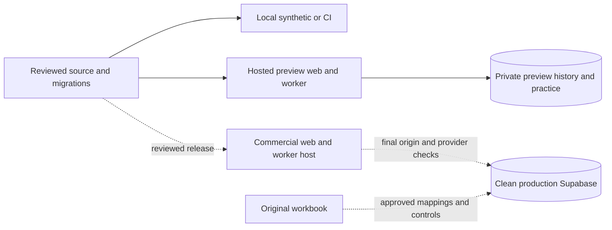
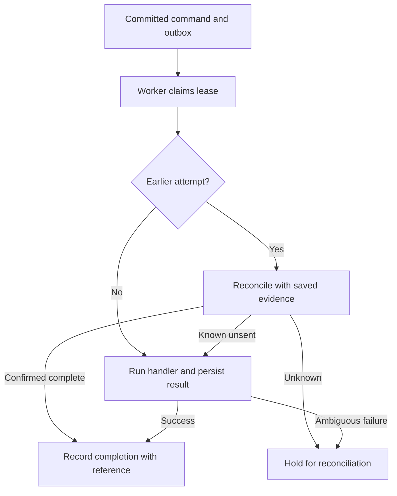

# Operations and release handoff

**As of 18 November 2026, the owner has chosen to keep the shared testing preview running. Commercial activation is pending.** A successor can develop and verify the full request, booking, payment, teaching and reporting workflows using local synthetic fixtures. The owner deferred the alternative free-host proposal. No paid upgrade or new hosting account has been approved. The first launch decision is where the web app, continuous worker and private upload scanner can operate under the owner's cost and commercial-use constraints. [Launch review](../IMPLEMENTATION-STATUS.md) · [Owner decisions](../PRODUCTION-INPUTS.md) · [Hosting proposal and constraints](../FREE-SERVICE-PLAN.md)

## 1. Identify the environment before running a command

| Target | What lives there | Appropriate work |
|---|---|---|
| New local synthetic stack | Two native foundation databases at loopback port 55432. A separate Docker Supabase project supplies Auth, application PostgreSQL, private Storage and captured Auth mail. Generated local accounts and fixture markers identify it. | Development, automated tests, independent connection races, simulated callbacks and isolated restore drills. Run suites against a dedicated disposable installation. |
| Retained local development and private workbook preview | The developer's existing data, private source material, import mappings and practice history. The operational preview has its own backend and private access instructions. | Preserve the data and existing Docker volumes. A checkout on the same machine can still share fixed ports and the Docker project name. Use a separate runner or machine for a clean-room test. |
| Hosted shared preview | Vercel web plus a Frankfurt worker and a distinct hosted Supabase project. Contains authorized historical records and clearly separate fictional practice. Signup is closed. | Authenticated walkthroughs within their authorized scope. The host calls its daemon deployment scope “Production” while the application runs in development mode. Ordinary meetings, outbound notifications, scans and payment practice use simulated/manual paths. One specifically bound booking exercised Google. |
| Clean hosted production database | Independent Supabase project with private Storage, Auth, restricted worker credentials and enforced TLS. On 18 November the read-only check saw **one unconfirmed owner Auth account, zero staff grants, zero import batches, zero financial postings, zero queued jobs, 35 restricted worker functions and zero unsafe private tables**. | Reviewed, separately authorized production preparation. The selected hostname, serving web and worker, live scanner, customer operations, completed owner activation and cutover remain outstanding. |
| CI | A fresh Ubuntu runner creates its own native foundation database container and Supabase stack. All business data is synthetic. | Reproduce setup from the lockfile and migrations and verify the specific revision under review. No production account or workbook is needed. |



There is no preview-database promotion step. Real identity, financial and source-history migration belongs to its own approved procedure. A workbook “Paid” or “Completed” label is a historical observation until independently substantiated. The archived example tunnel in older demo instructions is also distinct from the current hosted pilot. Access the private preview with the owner's private access guide. [Hosted and portable deployment](../DEPLOYMENT.md) · [Operational data plan](../OPERATIONAL-DATA-PLAN.md) · [Actual data import](../ACTUAL-DATA-IMPORT.md)

### Current build and database evidence

| Evidence | What was established |
|---|---|
| Shared preview, 18 November | Vercel reported application revision `999ebad` ready. Authenticated learner/owner checks exercised the new booking and workbook controls. Tutor and service navigation was checked on additional screen sizes. The bounded learner inspection examined the booking HTML, materials and eight JSON responses for privileged fields. |
| Full CI, 18 November | Revision `459de31` changed the browser assertions and status record after `999ebad`. The application code matched the deployed preview. The saved CI run passed lint, types, **463 unit checks across 67 files, 306 integration checks across 90 files, 168 desktop/mobile browser checks** and the build. Two opt-in guided-demo cases were skipped. Both database checks saw 156 migrations, 239 private tables with row-level security and 744 function boundaries. The immutable run is linked in the “Portal navigation” entry of the status record. |
| Production migration work | The last documented complete migration inventory for the clean target was 154. The two 18 November Calendar migrations were subsequently applied to the authorized preview. The repository contains 156 versioned SQL files. Re-read the selected target's migration list and compare against the chosen commit during activation. The 18 November clean-database role and data-count check is a separate measurement. |
| Formal release evidence | The acceptance catalogue has 147 cases. Its validated state is **0 recorded passed / 147 not run**. An individual automated check, preview demonstration or screenshot does not supply the immutable case-level result required by the formal catalogue. |

[Dated results and CI source](../IMPLEMENTATION-STATUS.md) · [Migration files](../../supabase/migrations) · [Acceptance evidence format](../EVIDENCE-WORKFLOW.md) · [Original task sequence](../superpowers/plans/2026-11-11-git-tutor.md)

## 2. First hour on a Windows development machine

Use PowerShell in the repository root. For a fresh setup choose a disposable machine with Linux-container Docker Desktop running, Node **24.22.1**, pnpm **11.25.0**, PostgreSQL **17** binaries and Python for the pack check. The Windows starter defaults to the installed PostgreSQL 17 `bin` directory under Program Files. If the binaries are elsewhere, set `GITTUTOR_POSTGRES_BIN` to that directory. The application pins Next.js 16.4.6, React 19.3.1 and Supabase CLI 3.1.0. On this repository the installed Next version's local guides govern framework edits. [Runtime pin](../../.node-version) · [Package scripts and tools](../../package.json) · [Required repository instructions](../../AGENTS.md) · [Contract spine](../00-contract-spine.md)

```powershell
git status --short --branch
git rev-parse --short HEAD
node --version
pnpm --version
docker version --format '{{.Server.Version}}'
python --version
pnpm install --frozen-lockfile
python tools/verify-pack.py
```

The Docker check must return a server version. A frozen installation preserves the reviewed lockfile. The pack verifier checks documents, references, scenarios and internal consistency. For a machine with pre-existing runtime files, identify which environment they belong to **before** bootstrap. Keep local manifests, test credentials, backup dumps, browser sessions, private review evidence and encryption material out of Git, messages and build contexts. Leave inherited hosted connection settings out of the clean local terminal. [Local startup](../../README.md) · [Windows database starter](../../tools/db-start.ps1) · [Git exclusions](../../.gitignore)

On the new isolated machine, run each command in order and check its exit code.

```powershell
pnpm db:start
pnpm db:migrate
pnpm seed:synthetic
pnpm db:verify
pnpm exec playwright install chromium
pnpm dev --hostname 127.0.0.1
```

| Step | What a healthy result looks like |
|---|---|
| Start | Native PostgreSQL listens on `127.0.0.1:55432` with `gittutor_dev` and `gittutor_test`. The Supabase wrapper then verifies its project and loopback target and creates its private local configuration. The application API/Auth gateway uses 54321, application PostgreSQL 54322, and the captured Auth inbox 54324. |
| Migrate | The native runner applies its T01 baseline. The Supabase runner applies the domain migrations. On a verified empty synthetic project it installs the older catalog in its original order and persists its bootstrap stage before advancing to later policy gates. A conflict or target-marker error needs investigation. Existing approved fixture rows and migration history have meaning. |
| Seed | The seed checks its target marker, creates or reuses synthetic Auth accounts, installs scoped roles and guardian links, and prepares catalog, scheduled sessions, packages and payment examples. Generated account details are in ignored `.local/supabase.json`. Keep this file private as it also contains privileged local settings. |
| Verify | Both native and Supabase boundary verifiers exit successfully. Compare the reported migration count to the checked-out revision. Grant failures are meaningful even if the landing page opens. |
| Open | Visit `http://127.0.0.1:3000`, `/subjects` and `/login`. A local signup verification appears in the captured Auth inbox at `http://127.0.0.1:54324`. Open different browser profiles for learner, guardian, tutor, customer service and admin. Auth mail is separate from simulated application notification files under `.local/email-inbox`. |

For hands-on exploration open a second PowerShell window in the same checkout and run `pnpm worker:dev`. Look for `worker_started`, the declared integration modes and registered handlers. A learner request with a private file should progress beyond pending scan, and a funded practice booking should get a simulated meeting. For an ordinary restart after successful setup, use `pnpm supabase:start`, the loopback web command and a separate worker. `pnpm supabase:restart` reloads local Auth configuration/templates while preserving volumes. Stop the general worker before integration tests, browser suites or demo preparation take control of job leases. [Local verification notes](../LOCAL-TESTING.md) · [Supabase bootstrap](../../tools/supabase-local.ts) · [Supabase config](../../supabase/config.toml) · [Guarded demo preparation](../DEMO-WALKTHROUGH.md)

### First-day verification

1. **Walk a request through separate accounts.** Start in `/learn/requests`, attach a synthetic course file, wait for its scan and submit. Staff use `/service/requests` or `/admin/requests` to match the request. The learner reserves the named learner's seat, accepts the exact quote and submits a practice receipt. Customer service claims the case, compares the receipt to a separate settled receiving-account entry, verifies source ownership and applies the funds. Check exactly one allocation and the resulting confirmation status. [Request-first flow](../REQUEST-FLOW.md) · [Payment review and independent evidence](../T06-MANUAL-STATEMENTS.md)
2. **Verify who can see the result.** Use the assigned tutor to retrieve the correct learner material after confirmation. Compare original/downloaded bytes. Check an unrelated learner's denial, the guardian's authorized scope and the absence of internal notes, compensation and destinations in customer responses. Use a prepared elapsed practice session for attendance/completion approval, then inspect the earning in the tutor/admin views. A future session cannot stand in for completed teaching. [Scoped file and teaching evidence](../T07-TEACHING-OPERATIONS-EVIDENCE.md) · [Completion controls](../T08-COMPLETION-CONTRACT.md)
3. **Exercise failures on the disposable stack.** Run separate-connection database tests for allocation/role conflicts and the fake recovery tests, then the request/role browser checks. Always reproduce with the general worker stopped. Playwright starts a loopback web server and can reuse an existing one outside CI. Confirm the server on port 3000 is the intended synthetic instance or stop that local server first. [Integration tests](../../tests/integration) · [Browser configuration](../../playwright.config.ts)

```powershell
pnpm exec vitest run tests/integration/payment-allocations.test.ts tests/integration/payment-authority.test.ts tests/integration/worker-recovery.test.ts
pnpm exec playwright test tests/e2e/requests.spec.ts tests/e2e/role-access.spec.ts
pnpm exec tsx tools/validate-evidence.ts fixtures/acceptance-cases.json
```

4. **Run the full local gate** on the disposable target. Use `pnpm db:verify`, then `pnpm check`, then `pnpm db:verify`. The composite command runs lint, TypeScript, units, integrations, Playwright and build. The database verifier, pack verifier and evidence validator have separate entry points. Keep the literal failed command, UTC timestamp, commit, target type, provider modes and redacted result if a stage fails. Vitest disables file-level parallelism and Playwright uses one worker because scenarios share canonical records. Tests for concurrency deliberately open independent database sessions. [Package scripts](../../package.json) · [Vitest configuration](../../vitest.config.ts) · [Acceptance requirements](../08-acceptance-tests.md)

**How CI differs.** GitHub Actions runs on pull requests, pushes to `main` and manual workflow dispatch. It runs Ubuntu 24.04, uses `APP_ENV=test`, installs pinned Node and pnpm, validates the pack/evidence, and installs Chromium with OS dependencies. It starts a fresh PostgreSQL 17.12 container at port 55432 with `tools/ci-native-database.ts`. It calls the native migration/seed scripts directly, then `pnpm supabase:start` and the Supabase migration/seed commands. It verifies database boundaries, runs lint/types/unit/integration/browser, verifies boundaries again and builds. The job has a 90-minute ceiling. The CI bootstrap checks `CI=true` and refuses an existing native database manifest. To reproduce the hosted check, use the workflow on a clean runner. [Actual CI workflow](../../.github/workflows/verification.yml) · [CI database setup](../../tools/ci-native-database.ts)

## 3. Worker, delivery and provider ownership

A business command writes its domain event/outbox work in the same database transaction as the state change. The durable worker claims up to ten eligible jobs by default with 60-second leases. It records the outcome through the restricted role, checks lease ownership and reconciles an earlier attempt before another dispatch. On SIGTERM/SIGINT it finishes processing the claimed batch, then exits its loop. Test shutdown under load on the selected host. [Atomic command and outbox contract](../03-architecture.md) · [Claims](../../src/worker/claims.ts) · [Worker loop](../../src/worker/index.ts) · [Reconciliation logic](../../src/worker/execute.ts)



| Worker purpose | Operational effect and diagnostic clue |
|---|---|
| `identity.staff_invitation` | Dispatches an authorized invitation through Supabase Auth, checks the saved provider identity on recovery, and preserves uncertain delivery. |
| `booking.process_due`, `packages.process_due` | Processes due holds/formation and package expiry. Check schedule instants, current versions, worker heartbeat and claim state when a due action is late. |
| `payments.validate_statement` | Validates statement source material. Subsequent review must independently establish the receiving account, settled funds, owner and available amount. |
| `files.scan`, `exports.render` | Reads private bytes for an authorized scan or writes scoped export output. A completed upload alone does not authorize a download. |
| `calendar.sync` | Prepares current occurrence and connection versions, provisions/updates/cancels the event, and records the resulting state. Authenticated room access also depends on current assignment/enrollment. |
| `notifications.route`, `notifications.send`, `support.whatsapp_send` | Routes domain events to eligible recipients, rechecks dispatch scope or channel rules, and persists delivery observations. Inspect both logical notification and attempt. |
| `foundation.healthcheck` | Local pure health job. The production worker's heartbeat healthcheck additionally requires a fresh successful poll or handler heartbeat within 180 seconds. |

An unrecognized purpose is recorded as `HANDLER_NOT_CONFIGURED`. A lost lease cannot finalize another worker's job. A generic handler exception may occur after the provider accepted a side effect and leads to reconciliation. `GET /healthz` returns web process liveness. Check the independent worker heartbeat and perform a controlled queue round trip before claiming hosted service health. [Handler registration](../../src/worker/index.ts) · [Worker heartbeat](../../src/worker/health.ts) · [Web liveness](../../src/app/healthz/route.ts)

### Mode and activation matrix

The accountable roles below are suggested assignments for the handover. Confirm the named people privately. Code allows fake adapters in development/test. Staging/production require complete live-adapter settings, and payment reconciliation uses `manual`. Only the public Supabase URL and publishable key go to the browser. [Runtime modes and key validation](../../src/server/config.ts) · [Production inputs](../PRODUCTION-INPUTS.md)

| Area and suggested owner | Current evidence | Required input and next acceptance check |
|---|---|---|
| Supabase Auth, database and Storage — platform operator and owner | Real local services, separate private preview and clean hosted database. Clean signup, anonymous access and autoconfirm disabled. Verified TLS, private bucket and restricted worker. | Configure final HTTPS site and allowed redirects with the chosen host, confirm owner identity and complete browser invitation/recovery. Check current roles, revocation, separate learner access and protected byte downloads on that target. |
| Application email — messaging operator | Local fake inbox. Mailjet is the selected SMTP transport. A controlled owner setup mail reached Spam. Gmail reached the owner's Inbox in an earlier alternative test. Resend and SES adapters exist. | Set `EMAIL_ADAPTER=mailjet` plus `EMAIL_FROM`, `MAILJET_API_KEY`, `MAILJET_SECRET_KEY` privately. The tracked production template still illustrates Gmail. Review the clean queue, sender, intended recipients and content before a worker test. SMTP acknowledgement means sent. Mailjet authenticated callbacks and automated reconciliation are unimplemented. Preserve unknown results and check provider evidence privately. [Mailjet operator guide](../MAILJET-SETUP.md) |
| Auth email — identity operator | Clean Supabase Auth uses Mailjet SMTP. On 16 November the owner-only invitation and recovery messages arrived in Spam, with temporary code bodies. Ordinary templates were restored. | Exercise both real browser links on the approved production origin, including setting a password and verifying the resulting session/role. Assess Spam placement and final sender setup. Application notification success and Auth link consumption require separate evidence. [Auth delivery record](../evidence/auth-mailjet-20261116.md) |
| Google Calendar/Meet — organizer and platform operator | Ordinary preview appointments simulate rooms. On 18 November an approved exact private booking, learner, tutor, organizer version and time were bound to Google. The organizer admitted the learner and two accounts joined. The OAuth audience is in Testing. | Register the final origin/callback, obtain the intended organizer's consent, protect/rotate token encryption keys and confirm the long-call entitlement. Verify create/update/cancel/recover, reassignment/revocation, and a real tutor plus learners through the promised 90–105-minute group duration. [Organizer guide](../GOOGLE-CALENDAR-SETUP.md) · [Preview-only booking scope](../../supabase/migrations/20261118135000_scoped_calendar_booking_pilot.sql) |
| WhatsApp — support owner and integration operator | Public contact link and web support exist. Automated inbound/outbound logic uses fake mode in ordinary preview. | Confirm launch scope. Cloud mode needs approved Meta business and phone IDs, token, app secret, verify token, Graph version and eligible templates. Verify webhook identity/signature, inbound, handoff, bot pause, opt-out, expired window and template delivery in a controlled conversation. A manual-only launch requires an approved scope and implementation change. [Security and support contract](../06-security-integrations.md) |
| Upload scanning — infrastructure operator | Development fake scanner and ClamAV adapter implemented. A 25 MiB hosted preview upload reached private Storage using nine pieces, was fake-scanned, authorized and downloaded byte-identically. | Supply private reachable `FILE_SCAN_URL` for `FILE_SCAN_ADAPTER=clamav`, signature updates, capacity and alerts. Establish safe acceptance, prohibited-content quarantine and fail-closed download behavior during scanner outage. Recheck large upload/interruption/retry/authorization on the final host. [Deployment file transport](../DEPLOYMENT.md) |
| Incoming payments, refunds and payroll — finance owner and reviewers | Independent manual settlement/reconciliation, immutable postings, reviewed payout destinations, unknown attempts and reversals are implemented. Practice activity used simulated funds. | Verify collection and payout destinations independently, approve policy versions and authorized reviewers, then reconcile an explicitly controlled incoming transfer, refund and tutor payout to separate evidence. Trace one allocation per source movement and compare cash, credits and payable controls. [Financial boundary](../T06-FINANCIAL-CONTRACT.md) · [Finance controls](../T08-FINANCE-CONTROLS-EVIDENCE.md) |

## 4. Prepare an authorized deployment

1. **Choose host, revision and owner.** Agree the permanent HTTPS origin, commercial-use eligibility, continuous worker capacity, secure scanner connectivity and cost. The current Vercel Hobby pilot and deferred Oracle option remain as recorded. Preserve the last known-good web and worker revisions/digests, current migration list and verified backup manifest. CI for a commit and a ready web deployment are different records. [Hosting decision](../FREE-SERVICE-PLAN.md) · [Build and deployment instructions](../DEPLOYMENT.md)
2. **Prepare migrations.** On a *brand-new, positively identified empty* hosted database, the database operator uses `deploy/bootstrap-owner-roles.sql` to grant the narrowly scoped SQL role memberships and temporary schema CREATE rights required by the migration chain. Revoke those temporary CREATE rights after migration or if interrupted. This script refuses existing Auth users or application relations. The already-prepared clean project contains an Auth user, so that fresh-target bootstrap is inapplicable. Verify every pending filename on the intended target. If authorized to apply, append the reviewed SQL without fixture seeding or changing existing migrations. [Empty-target SQL](../../deploy/bootstrap-owner-roles.sql) · [Migration targeting](../DEPLOYMENT.md)

```powershell
pnpm exec supabase migration list --remote=SELECTED_PROJECT_REF
pnpm exec supabase db push --remote=SELECTED_PROJECT_REF --dry-run --skip-vault
```

   Replace the placeholder with the reviewed project reference using the authorized operator profile. After backup, approval and review of this dry run, the documented apply command is `pnpm exec supabase db push --remote=SELECTED_PROJECT_REF --skip-vault --yes`. Re-list the migration history afterward. Never apply synthetic seed, demo, operational-preview or reset tools to production. The two Calendar migrations add versioned behavior with environment guards. Review their effects as part of the complete 156-file candidate.

3. **Check target and credentials.** Runtime settings come from the host's secret manager. Set explicit `APP_ENV=production`, `APP_BASE_URL`, the selected project URL/public key, private Supabase key, restricted `WORKER_DATABASE_URL`, versioned encryption key plus any required previous keys, and selected provider settings. Isolate the operator's `PRODUCTION_DATABASE_URL` and `PRODUCTION_PROJECT_REF` from the deployed services. Use the selected project's direct database or session pooler on 5432 with certificate-verified TLS and the shipped public CA. The service role and worker may do only what each trusted server path requires. [Runtime key inventory](../../deploy/production.env.example) · [Operator-only inventory](../../deploy/preflight.env.example) · [Reviewed RPC allowlist](../../tools/production-worker-boundary.ts)
4. **Run preflight from the reviewed checkout.** Use private files outside Git on the authorized operator machine. The second invocation opens read-only operator and worker transactions. It checks project identity, no fixture marker or test identities, applied migration versions, worker's exact effective RPC signatures and ownership, current row-level security and absence of raw table grants. An exit code of 1 blocks promotion. A config-only result of `configuration_valid_target_unverified` allows the database check to follow. The best full result is `technical_checks_passed_activation_pending`. Commercial, recovery and live-provider evidence still have separate signoffs. [Preflight runner](../../tools/production-preflight.ts) · [Individual preflight checks](../../tools/production-preflight-model.ts)

```powershell
node --env-file=C:/private/git-tutor-runtime.env --env-file=C:/private/git-tutor-preflight.env --import tsx tools/production-preflight.ts --config-only
node --env-file=C:/private/git-tutor-runtime.env --env-file=C:/private/git-tutor-preflight.env --import tsx tools/production-preflight.ts
```

5. **Bootstrap the first human administrator.** Database “owner roles” in the bootstrap SQL own functions. Application admin authority is a current `account_roles` grant to a verified person. On the clean project, finish the intended owner's controlled Auth browser activation, verify identity/ownership privately and confirm its application account. The repository documents first-admin insertion only for a guarded synthetic seed. A reviewed operator procedure for the first production grant with an auditable reason and exact verified account is a cutover dependency. Never copy the local seed or trust user-editable Auth metadata. Verify a fresh owner session has the expected access via `/api/v1/me` and `/admin/access`. Subsequent staff onboarding uses the admin invitation/grant flows. Verify a regular account cannot enter and test revocation with its previously valid session. [Auth boundaries and first local admin](../T02-AUTH-PREFLIGHT.md) · [Identity commands](../../src/modules/identity/commands.ts) · [Access workspace](../../src/app/admin/access/page.tsx)
6. **Build and stage web and worker together.** Portable deployment has separate `web` and `worker` Docker targets, both non-root. Build both from the reviewed source, then publish authorized images to a private registry and record immutable digests. Compose expects `GIT_TUTOR_WEB_IMAGE`, `GIT_TUTOR_WORKER_IMAGE` and an absolute `GIT_TUTOR_ENV_FILE`. It gives services read-only roots and 120 seconds of shutdown grace. The hosting operator supplies HTTPS ingress, private scanner, secret storage, restart policy, alerts and backups. The Vercel root config describes web only. Its committed daemon example starts with zero instances. The existing pilot used a private override for one worker. No automatic Git promotion is documented for the pilot. [Docker targets](../../Dockerfile) · [Compose](../../compose.production.yml) · [Vercel config](../../vercel.json) · [Daemon example](../../deploy/vercel-daemon.example.json)

```powershell
docker build --target web --tag gittutor-web:production-check .
docker build --target worker --tag gittutor-worker:production-check .
pnpm exec tsx tools/verify-production-images.ts
```

   This packaging smoke uses a newly labelled, disposable PostgreSQL container and stub queue. It covers image contents, non-root/readonly startup, web header/logo checks, idle worker heartbeat and termination, and rejection of invalid production configuration. It leaves failed test resources for diagnosis. The hosted launch still requires a real queue round trip and in-flight termination/reconciliation. [Image verifier](../../tools/verify-production-images.ts)

7. **Reconcile data cutover and open writes deliberately.** Use the original source checksum, immutable row links and reviewed person/course mappings. The preview's recorded baseline was 139 source links, five canonical students, eleven tutors and eighteen courses. Verify account ownership, guardian authority, disputed duplicates and opening balances independently. Preserve unknowns and label historical reporting. Exclude generated preview logins, synthetic policies, practice transactions and jobs. Test customer-safe records, files, exports and notifications in every role on the prospective host. Record the operator, migration version, source counts, image digests, oldest pending job and finance controls at the write boundary. [Import restrictions and reconciliation](../ACTUAL-DATA-IMPORT.md) · [Launch checks](../PRODUCTION-INPUTS.md)

## 5. Backup, rollback and incident response

**Last measured recovery.** On 15 November, the authorized hosted development source was read over verified TLS using an exported read-only snapshot and restored into a **new local** database and private bucket. The exercise matched 238 business, 27 Auth and 10 Storage-metadata table counts/hashes, 154 migration records, 139 workbook links and 29 objects totaling 26,239,916 bytes. All 28 registered files matched their original application hashes. Public access was denied, a revoked session lost access and the expired fake lease reconciled with zero redispatch. Core restoration took 154.701 seconds. Complete verification, including repair of a local role-switch error, took 271.137 seconds. These timings apply to those targets and contents. [Redacted recovery evidence](../evidence/hosted-source-recovery-20261115.md)

**Local rehearsal.** On a dedicated *marked loopback synthetic* target containing at least one private object, stop the normal worker and run `pnpm exec tsx tools/recovery-rehearsal.ts`. The runner creates a unique test event, exports a snapshot and linked private files, creates a new local database/bucket, exercises current authorization and reconciles a fake expired lease. Preserve the output and private manifest under `.local/recovery`. This tool has no hosted replacement mode. [Local restore runner](../../tools/recovery-rehearsal.ts)

**Replacement-host procedure still to prove.**

1. The owner and operations lead choose the accountable operator, off-device protected backup location, retention, recovery-point objective (maximum data loss) and recovery-time objective (time to restore service). The four-hour staging rehearsal target in the original contract is a starting point. Production objectives are still undecided.
2. Capture coordinated database/Auth/Storage-metadata snapshots, migration history, private bytes and checksums, source controls and pending/unknown work summaries at a known UTC cutoff. Retain key identifiers and recoverable encryption material, Auth configuration and signing-key recovery arrangements separately. A database dump contains sensitive records and does not itself supply every stored object or host setting.
3. Restore to a separately identified replacement host/project. Keep outbound delivery and new writes closed. Reinstall matching migrations, private buckets, policies, restricted worker privileges and matching runtime configuration. Check row counts/hashes, immutable file lengths/hash, current-session authorization, denied private/public access and browser Auth paths.
4. Reconcile holds/seats, lots/reservations/consumption, allocations and customer credits, refunds, earned tutor payable/payouts and expenses against the recorded cutoff. For unknown outgoing operations, inspect independent settlement or provider evidence before releasing value or resuming dispatch. Retain each original posting and any linked correction. Verify exactly one effect after replay and compare post-replay totals.
5. Measure both achieved objectives, including time to working web/worker, Auth and protected downloads, then rehearse traffic change, write resumption and monitoring. Preserve redacted results and a new immutable manifest. The 15 November run left hosted failover, JWT/key recovery, deployed Auth journeys, continuous backups and production recovery intervals open. [Release/recovery contract](../09-setup-release.md) · [Production input owners](../PRODUCTION-INPUTS.md)

**Rollback decision.** For an application regression, first record the current web and worker revisions, migration versions, write cutoff and affected commands/jobs. Close affected writes or pause dispatch at the hosting layer as appropriate, preserving the outstanding queue and private evidence. If the last verified image pair is compatible with the deployed schema, redeploy that pair, recheck web liveness, worker heartbeat, role access and a controlled journey, and reconcile jobs accepted during the change. For incompatible schema or data, keep writes closed, evaluate a reviewed additive repair or restore onto a separate verified target and reconcile activity since the backup. Switching traffic back does not reverse recorded settlements or external sends. Finance corrections use referenced adjustments and verified outcomes. No one-command production rollback, destructive migration reversal or replacement-host drill is documented as passed. [Deployment](../DEPLOYMENT.md) · [Financial correction rules](../02-business-rules.md) · [Recovery evidence](../RELEASE-READINESS.md)

### Triage by symptom

| Symptom | First checks and disposition |
|---|---|
| Docker client works but engine is absent after Windows restart | Check the engine and inspect the actual Docker Desktop backend error. For the specifically observed stale runtime socket, the recovery record describes stopping Docker/WSL, verifying the exact runtime-only directory, preserving it and recreating it. Keep distributions, volumes and data disks intact. Verify Auth/Storage, authenticated read and both databases before bringing the web/worker back. [Docker Desktop recovery record](../DOCKER-RECOVERY.md) |
| Database target refused, port occupied, or fixture conflict | Inspect the intended project/port and marker with private tooling. On Windows the native starter refuses a foreign listener or unowned data directory. Supabase migration/seed and integration helpers reject the wrong marker. Switch to the correctly identified disposable target or a clean runner, and preserve the conflicting records. [Windows starter](../../tools/db-start.ps1) · [Target guards](../../tests/helpers/supabase.ts) |
| Login page works but jobs, scans or mail stall | Check worker availability and heartbeat, mode/handler registration, oldest due job, lease expiry and error code. Check storage and provider reachability separately. For local Auth email inspect Mailpit; for fake application mail inspect the private inbox. Investigate `unknown` before retry. [Worker](../../src/worker/index.ts) · [Notification operations](../../src/app/admin/notifications-operations/page.tsx) |
| Uploaded file will not open | Verify final chunk adoption/hash, scan result, publication if shared, current session and relationship. Upload staging uses private cleanup manifests. For adopted files verify the complete canonical object before removing only manifest-listed staged chunks. Preserve disputed/incomplete bytes pending authorized retention policy. [Private upload staging and cleanup](../DEPLOYMENT.md) |
| Receipt exists but booking remains held | Verify active reviewer claim/version, independent receiving-account settlement and source owner, matching destination/currency/amount, available allocation, current quote consent, hold/deadline and any group-formation requirement. Compare the receipt and transfer histories at `/service/payments` and admin reconciliation. Resolve through authorized commands. [Payment evidence](../T06-DATABASE-EVIDENCE.md) · [Booking funding](../T06-BOOKING-FUNDING-EVIDENCE.md) |
| Refund/payout response timed out | Retain the existing attempt, reservation, destination version and external evidence. Finance reconciles the independent statement/provider result, then records settlement, verified failure or the referenced reversal. An uncertain attempt can still have moved money. [Finance controls](../T08-FINANCE-CONTROLS-EVIDENCE.md) |
| Room missing near start or unexpected scope denial | Check confirmation, occurrence/roster version, assigned tutor, enrollment state, organizer verification/revocation, event state and calendar job. Ordinary preview uses simulated rooms. Keep exact pilot eligibility intact. Use the existing current-version recovery flow. [Calendar evidence](../T07-CALENDAR-EVIDENCE.md) · [Organizer guide](../GOOGLE-CALENDAR-SETUP.md) |
| Preflight fails or web deploy appears healthy without a working backend | Inspect the named failed check, selected project/hostname, current migration set, TLS CA/hostname and exact worker role/grants. On a genuinely fresh target verify the owner-role prerequisite for default privileges. A successful web build provides no evidence about the database role or background queue. [Preflight checks](../../tools/production-preflight-model.ts) · [Deployment](../DEPLOYMENT.md) |

For a production incident, use correlation and run identifiers in the private incident record, UTC times, application/worker revision, migration version and redacted safe error codes. Track the oldest payment review, unallocated funds, unknown refund/payout attempts, imminent missing meetings, scan or queue age, unowned support cases, failed critical delivery and finance differences. Determine which alerts and thresholds are actually configured on the selected host. The contract lists monitoring requirements; host alert setup remains release work. [Operational visibility requirements](../09-setup-release.md)

## 6. Priorities for the receiving team

| Priority | Suggested accountable role | Exit evidence |
|---|---|---|
| 1. Decide commercial host and cost boundary | Business owner + infrastructure lead | Written host decision covering permitted use, permanent HTTPS origin, continuous worker, scanner connectivity/memory and off-device backups. Keep current preview while deferred. |
| 2. Close isolated financial/access gaps in parallel with owner decisions | Finance-domain engineer + QA | Run the five literal checks below on a disposable target. Record winners, losers, unchanged controls, actual rows and replay results per case. Cover remaining formal variants through the acceptance maps. |
| 3. Approve business inputs and real-data mapping | Owner + finance + customer operations | Complete policy versions, reviewed destinations/agreements, independently evidenced opening entries, reviewed learner/guardian authority and a checksum/count cutover manifest. Resolve explicitly which records can stay historical/unresolved. |
| 4. Rehearse clean host identity, uploads and dispatch | Platform + identity/messaging operators | Full preflight, verified first admin, real browser Auth links, expected current-role denial, scoped file quarantine/revocation, worker restart under load, reviewed recipient set and evidence for the selected WhatsApp scope. |
| 5. Run approved external pilots | Owner + finance + organizer + QA | A controlled settled incoming transfer/refund/payout tied to independent records, the selected email channel's actual outcomes, a multi-party group meeting lasting through the promised duration and tested changes/cancellation. Record target, authorization and remaining limits privately. |
| 6. Rehearse replacement, then make the release decision | Infrastructure + finance + release owner | Isolated replacement database/Storage/key/Auth restoration, replay of unknown outcomes, reconciled totals, measured recovery targets, complete case evidence, release revision/digests and agreed rollback owner. |

### Five concrete financial/access cases still requiring literal evidence

| Case | What the new test must establish | Starting point |
|---|---|---|
| GT-1403 | Race a fully eligible settled transfer approval against receipt replacement on independent database connections. Check the legal winner and the losing version/scope outcome, with no duplicate allocation or stale-proof approval. Existing coverage includes a sequential replacement with an unsettled transfer. | [Payment allocations](../../tests/integration/payment-allocations.test.ts) |
| GT-1405 | Revoke the payment reviewer's staff membership after acquiring a valid claim. Exercise the command with the original still-valid token and claim and verify no unauthorized result or money movement. | [Payment authority](../../tests/integration/payment-authority.test.ts) |
| GT-1317 | Race the actual versioned cancellation and completion commands for the same package-backed delivery. Assert one lawful outcome and consistent reservation, use/restoration, reference and financial state across commands. | [Package movement kernel](../../tests/integration/package-movement-kernel.test.ts) |
| GT-1510 | Execute one funded package purchase through delivery. Use the acceptance fixture's exact integers, show the corresponding decrease in deferred liability and increase in earned revenue in the same journey, and demonstrate cash remains unchanged at delivery. | [Activation checks](../../tests/integration/package-activation.test.ts) · [Completion checks](../../tests/integration/completion-packages.test.ts) |
| GT-806 | Restore an actual synthetic payout attempt in unknown state, reconcile its independent outcome and replay. Prove exactly one cash posting and correct remaining payable/reservation. Generic worker lease reconciliation is already covered separately. | [Worker recovery](../../tests/integration/worker-recovery.test.ts) · [Recovery runner](../../tools/recovery-rehearsal.ts) |

These are documented gaps in execution evidence. Record an actual observed failure before classifying one as a defect. Each formal pass needs the full Git revision, actual command and exit, UTC times, environment/provider mode, migration version, case/test and parameter results, immutable artifact and SHA-256. Preserve failed runs. Update the implementation status and release record with the bounded result, its target and any outstanding owner decision. [Gap review](../IMPLEMENTATION-STATUS.md) · [Acceptance register](../../fixtures/acceptance-cases.json) · [Evidence workflow](../EVIDENCE-WORKFLOW.md) · [Early case map](../T01-T06-ACCEPTANCE-MAP.md) · [Later case map](../T07-T09-T13-ACCEPTANCE-MAP.md)
